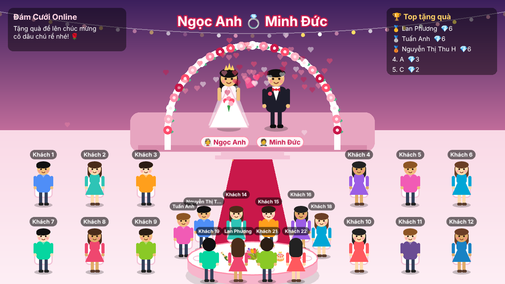

# 💍 Đám Cưới Online – TikTok Live

Game đám cưới chạy trên web (ASP.NET Core 8 + Phaser 3 + SignalR), kết nối với **TikTok Live**:

- Cô dâu chú rể đứng trên sân khấu, **12 khách** (tùy chỉnh 4–24) hai bên lối đi và **bàn tiệc 10 người** (0–12) ở cuối thảm đỏ.
- Có người **tặng quà** trên live → 1 khách **đổi tên theo người tặng**, cầm quà đi lên tặng cô dâu chú rể rồi về chỗ.
- Quà lớn (≥ 99💎) → pháo hoa, chớp sáng, cô dâu chú rể nhảy lên.
- **Bình luận** → khách nói bong bóng chat. **Thả tim** → tim bay. **Follow/Share** → thông báo.
- Bảng **Top tặng quà**, hàng đợi khi đông, combo (Rose x15) được gộp thành 1 lượt.



## Kiến trúc

```
TikTok Live ──► tiktok-bridge (Node.js) ──HTTP POST──► WeddingLive (.NET) ──SignalR──► Trang sân khấu (Phaser)
                TikFinity / Streamer.bot ──webhook──┘                         └──────► Trang admin
                                                                     OBS / TikTok LIVE Studio quay trang sân khấu
```

| Thư mục | Nội dung |
|---|---|
| `WeddingLive/` | Server ASP.NET Core: API nhận sự kiện, hàng đợi quà, SignalR hub, web tĩnh |
| `WeddingLive/wwwroot/index.html` | Sân khấu game (dùng làm Browser Source) |
| `WeddingLive/wwwroot/admin.html` | Bảng điều khiển: giả lập quà, xem trạng thái bridge |
| `tiktok-bridge/` | Script Node.js đọc TikTok Live bằng `tiktok-live-connector` |

## Chạy thử (không cần live)

Yêu cầu: [.NET 8 SDK](https://dotnet.microsoft.com/download/dotnet/8.0)

```bash
cd WeddingLive
dotnet run
```

- Sân khấu: http://localhost:5000
- Điều khiển: http://localhost:5000/admin.html → bấm **10 quà ngẫu nhiên** để xem khách đi lên tặng quà.

Hoặc mở `WeddingLive.sln` bằng Visual Studio rồi F5.

## Kết nối TikTok Live thật

### Cách 1 – tiktok-bridge (khuyên dùng)

Yêu cầu Node.js 18+.

```bash
cd tiktok-bridge
npm install
cp .env.example .env     # Windows: copy .env.example .env
```

Sửa `.env`: `TIKTOK_USERNAME` = tên TikTok đang live, `SERVER_URL` = địa chỉ server .NET.
Nên đăng ký `EULER_API_KEY` miễn phí ở https://www.eulerstream.com (dịch vụ ký request mà thư viện dùng, không có key dễ bị giới hạn).

```bash
npm start
```

Bắt đầu live trên TikTok trước, bridge sẽ tự kết nối lại mỗi 5s → 60s cho đến khi bạn lên sóng.
Trang admin hiện 🟢 khi đã kết nối.

### Cách 2 – TikFinity / Streamer.bot

Tạo action "Webhook" (GET) khi nhận quà, gọi:

```
http://localhost:5000/api/events/webhook/gift?key=API_KEY&username={username}&nickname={nickname}&gift={giftname}&count={repeatcount}&coins={coins}
```

(tên placeholder `{...}` tùy phần mềm, xem tài liệu của TikFinity/Streamer.bot).

## Đưa lên live (OBS / TikTok LIVE Studio)

1. Thêm nguồn **Browser Source**, URL `http://localhost:5000`, kích thước **1280 × 720**.
2. Muốn nền trong suốt để chồng lên camera: `http://localhost:5000/?bg=0`.
3. Live dọc 9:16: đặt Browser Source 1280×720 rồi crop/scale theo ý, hoặc sửa `W, H` trong `wwwroot/js/game.js`.

## Cấu hình – `WeddingLive/appsettings.json`

```json
"Wedding": {
  "Title": "Đám Cưới Online",
  "BrideName": "Ngọc Anh",
  "GroomName": "Minh Đức",
  "GuestCount": 12,          // 4 - 24 khách đứng hai bên lối đi
  "TableGuests": 10,         // 0 - 12 người ngồi bàn tiệc (0 = không có bàn)
  "ApiKey": "",              // đặt khóa bí mật khi chạy trên server public
  "BigGiftDiamonds": 99,     // từ mức này trở lên bắn pháo hoa
  "DispatchDelayMs": 250     // giãn cách giữa 2 quà
}
```

Sửa file khi app đang chạy là có hiệu lực ngay (F5 trang sân khấu để đổi tên/số khách).

## API

Tất cả `/api/events/*` yêu cầu header `X-Api-Key` (hoặc `?key=`) nếu `ApiKey` khác rỗng.

| Method | URL | Body |
|---|---|---|
| POST | `/api/events/gift` | `{ userId, nickname, avatarUrl?, giftName, count, diamondValue }` |
| POST | `/api/events/chat` | `{ userId, nickname, comment }` |
| POST | `/api/events/like` | `{ userId, nickname, likeCount }` |
| POST | `/api/events/social` | `{ userId, nickname, action: "follow" \| "share" \| "join" }` |
| POST | `/api/events/status` | `{ connected, username, message }` (bridge báo trạng thái) |
| POST | `/api/events/reset` | xóa bảng xếp hạng + tên khách |
| GET | `/api/events/webhook/gift` | query `username, nickname, gift, count, coins` |
| GET | `/api/config` | cấu hình cho sân khấu |
| WS | `/hub/wedding` | SignalR: `GiftReceived`, `ChatReceived`, `LikeReceived`, `SocialReceived`, `Leaderboard`, `BridgeStatus`, `ResetStage` |

Test nhanh bằng curl:

```bash
curl -X POST http://localhost:5000/api/events/gift -H "Content-Type: application/json" -d '{"userId":"lan","nickname":"Lan","giftName":"Rose","count":10,"diamondValue":1}'
```

## Tùy biến

- **Hình nhân vật**: đang vẽ bằng code trong `wwwroot/js/characters.js`. Muốn dùng ảnh/sprite riêng, thay phần vẽ trong `makePerson()` bằng `scene.add.sprite(...)`.
- **Emoji quà**: bảng `GIFT_EMOJI` trong `wwwroot/js/game.js`.
- **Lưu ý**: `tiktok-live-connector` là thư viện không chính thức, TikTok đổi giao thức thì cần `npm update`.
